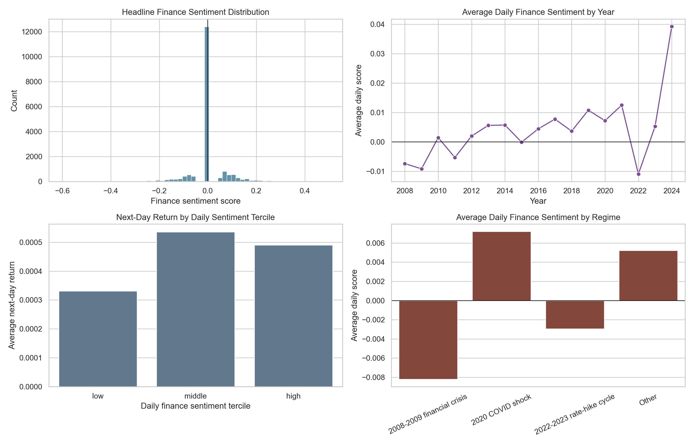

[English](README.md) | [简体中文](README.zh-CN.md)

# Does Financial News Sentiment Move the S&P 500?

This five-person capstone tested whether daily financial-news sentiment adds useful information for next-day S&P 500 direction and returns. The project uses time-aware evaluation and reports weak or unstable signals directly instead of selecting only favorable backtests.

## Data and methods

- 19,127 raw headline observations from January 2008 to March 2024.
- 18,153 cleaned headline rows and 3,506 daily market observations.
- Dictionary sentiment, VADER, FinBERT, and LDA topic features.
- FRED market context, including volatility, rates, inflation, unemployment, and recession indicators.
- Logistic regression and XGBoost for next-day direction.
- Training before 2020, validation in 2020-2021, and testing from 2022 through March 2024.
- Threshold scans, market-regime analysis, and backtests with explicit trading assumptions.

## Main conclusion

The evidence is mixed and mostly cautious. Some finance-specific sentiment features appear useful in selected periods, but classification accuracy remains near chance, return models show limited improvement over a historical-mean benchmark, and strategy performance changes materially with market regime, threshold choice, and transaction assumptions.

The strongest balanced accuracy was 51.4%. In one reported test-period backtest, the FinBERT logistic strategy returned 13.1%, compared with 7.0% for buy-and-hold. That result is presented with its sensitivity checks rather than as evidence of a stable trading edge.

## Explore the results

Open [`site/index.html`](site/index.html) for the static interactive summary. It includes sentiment-method comparisons, test ROC curves, regime-level returns, robustness checks, and return-model predictions.

- [Six-page capstone report](report/capstone-report.pdf)
- [Contribution and availability note](docs/contribution-and-availability.md)

## My contribution

My primary role was evaluation lead: I was responsible for threshold analysis, market-regime evaluation, backtest assessment, and explaining the limits of the predictive results. I also participated in the team's data-processing and modeling discussions, result interpretation, and final integration. The sentiment models and end-to-end pipeline were completed collaboratively rather than by one person.

## Reproducibility

This repository contains the public report, aggregate figures, and interactive result summary. The original training code and prepared dataset are not available in the course archive, so the reported models cannot currently be rerun end to end. Raw news headlines are not redistributed.

