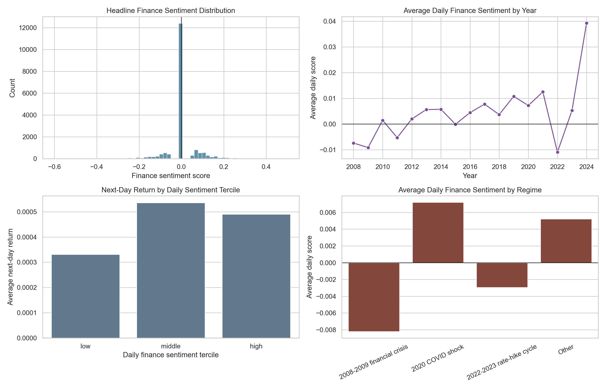

[English](README.md) | [简体中文](README.zh-CN.md)

# 金融新闻情绪是否影响标普 500

该五人顶点项目研究每日金融新闻情绪是否能为标普 500 次日涨跌和收益提供额外信息。项目采用时间顺序评估，并如实报告较弱或不稳定的信号，而不是只展示表现最好的回测。

## 数据与方法

- 2008 年 1 月至 2024 年 3 月的 19,127 条原始标题。
- 清洗后 18,153 条标题和 3,506 个日度市场观测。
- 词典情绪、VADER、FinBERT 和 LDA 主题特征。
- 来自 FRED 的波动率、利率、通胀、失业率和衰退指标。
- 使用逻辑回归与 XGBoost 预测次日方向。
- 2020 年前为训练集，2020-2021 年为验证集，2022 年至 2024 年 3 月为测试集。
- 阈值扫描、市场状态分析及明确交易假设的回测。

## 主要结论

证据总体较为谨慎。部分金融领域情绪特征在特定时期有一定信息，但分类准确率接近随机水平，收益模型相对历史均值基线的改进有限，策略表现也明显依赖市场状态、阈值和交易假设。

最高平衡准确率为 51.4%。一个测试期回测中，FinBERT 逻辑策略收益为 13.1%，买入持有为 7.0%；仓库同时呈现敏感性检查，不将该结果描述为稳定交易优势。

## 查看成果

打开 [`site/index.html`](site/index.html) 可查看静态交互总结，包括情绪方法比较、测试集 ROC、不同市场状态下的回测、稳健性检查和收益预测。

- [六页顶点项目报告](report/capstone-report.pdf)
- [个人贡献与材料说明](docs/contribution-and-availability.md)

## 个人职责

本人主要担任评估负责人，负责阈值分析、市场状态评估、回测检验和结果局限表达；同时也参与团队的数据处理与建模讨论、结果解释和最终整合。情绪模型和端到端流程由团队协作完成，并非由某一人独立完成。

## 复现范围

仓库包含公开报告、聚合图表和交互式结果页，但课程归档中没有原始训练代码和处理后数据，因此目前不能端到端重新训练模型；原始新闻标题也不在仓库中分发。

